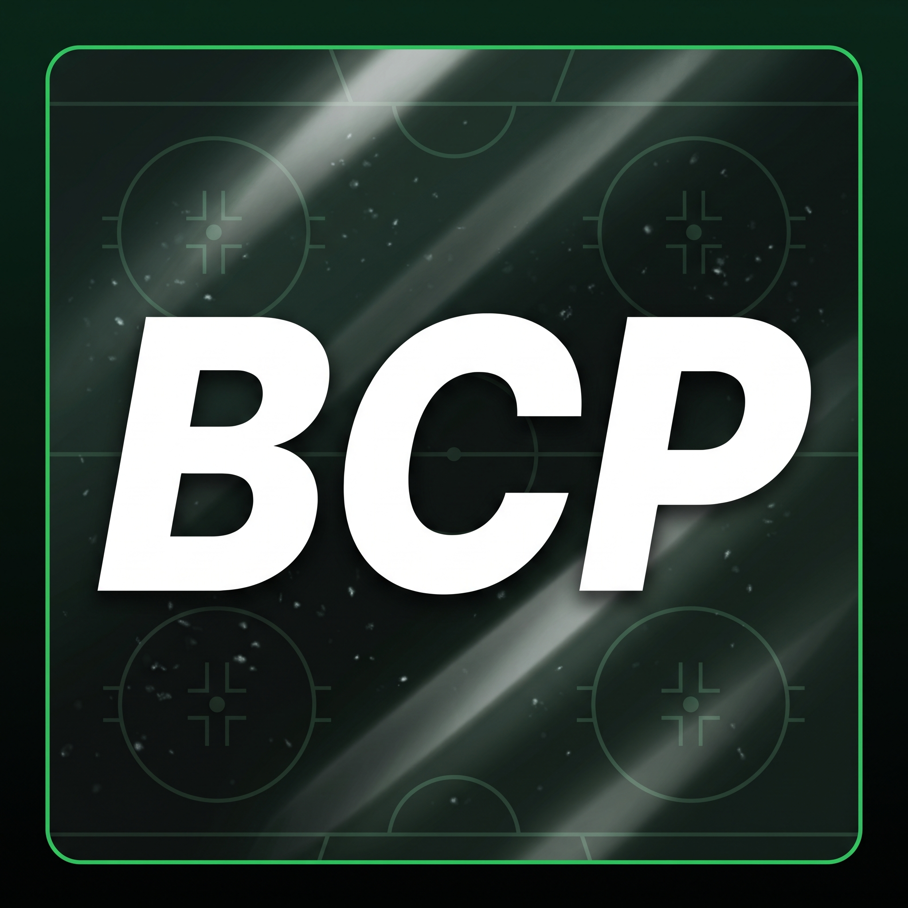

# Blue Chip Prospect

A text-based hockey career simulator that runs in your browser. You start as a 16-year-old prospect and play out a whole career, from junior hockey and draft night to the NHL, the Olympics and retirement.

**Play it at [blue-chip-prospect.com](https://blue-chip-prospect.com)**

## What it is

You make every decision in a hockey career. Where to play junior, how to train, which contract to sign, what to say to the media, whether to ask for a trade, and when to hang up the skates. Each season is played through choices, short events and position-specific minigames. The game is built to be as close to real hockey as possible, so leagues, playoff formats, contracts, the draft and international hockey follow the real rules.

## Features

**Getting there**
- Create a skater or a goalie, pick a nationality and choose a route: the CHL, the USHL, the NCAA or the junior leagues in Sweden and Finland
- Combine testing, a scouting board that moves during your draft year, and a full seven-round, 224-pick NHL Draft with a lottery
- Every NHL club drafts with its own general manager's habits, its prospect pool and its team needs, so where you go depends on more than your ranking

**Playing it**
- Preseason training and camp battles for a roster spot
- Position-specific minigames for breakaways, faceoffs, one-timers, shot blocks, open-ice hits, shootouts and more
- Press conferences, dressing room storylines, rivalries and coaching changes
- A trade deadline, mid-season call-ups and send-downs, injuries and slumps
- Playoffs that use each league's real format, including play-in rounds, plus the Memorial Cup and All-Star weekend

**Contracts and business**
- Entry-level deals, restricted and unrestricted free agency, qualifying offers, offer sheets and salary arbitration
- Offers are priced against comparable players from your own draft class
- Contract negotiation, signing bonuses, no-trade and no-movement clauses, and buyouts
- Agents, trainers and lifestyle purchases in the store

**International hockey**
- World Juniors, World Championships and the Olympics
- IIHF divisions with promotion and relegation, group tables and medal rounds

**The long game**
- Aging, declining ratings, career-ending injuries and forced retirement
- Real club and league records you can break, sourced from published record books
- Awards, All-Star teams, achievements and a Hall of Fame case
- A retirement screen with your Career Score, every season you played and how your career compares to the rest of your
